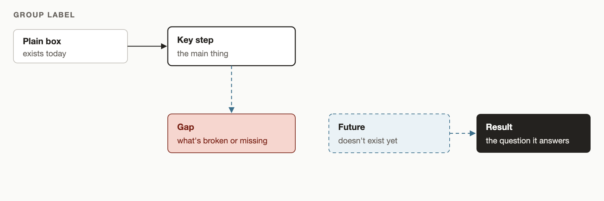

# Rich doc

A skill for getting briefings, primers and plans from your agent that you can take in at a glance. Each one leads with what you need to decide or know, draws structure as diagrams, puts comparisons in tables and keeps the evidence trail underneath, all in Markdown you can review and comment on.



The skill's diagram template. Every box kind means one thing (exists, the main step, broken or missing, doesn't exist yet, the result), so a plan's diagram shows at a glance what is new and what is missing.

## What you get
- **Briefings** on a person, organisation, project or decision: a decision box (decision · recommendation · why), one whole-picture diagram, the evidence, and any draft message ready to send.
- **Primers** on a topic or tool: the key points first, one diagram of how it fits together, then the detail and where to read next.
- **Plans** for your review: a TL;DR, the decisions you need to make, and a before-and-after diagram of what the plan changes, plus a sequence diagram when the order of steps matters.
- **Your brand, only where it belongs.** Give a project a `.rich-doc/brand.json` (palette roles, font, usage notes) and docs for that project use it. Everything else gets a calm default palette. A small script picks the brand for each doc and recolours Mermaid and SVG diagrams to match.

Diagrams are Mermaid by default, so they stay editable text, with hand-written SVG for the one picture whose layout carries the argument. Screenshots are used where a source's look is the evidence, and at most one live widget where the doc ends in an action.

## Requirements
- A Markdown viewer that renders Mermaid and GitHub-style callouts. GitHub does, and so does the Roughdraft review app, which also runs the optional live widget.
- For screenshots and SVG previews: Python 3 with Pillow, and Google Chrome (or set `$CHROME`).

## Installation

```bash
npx skills add HartreeWorks/skill--rich-doc
```

## Try it

Ask your agent:

```text
Write me a plan, as a rich doc, for moving our team's task tracking from Trello to Linear. Include the decisions I need to make.
```

You get a Markdown file that opens with a TL;DR and a decision box, then a before-and-after diagram of your tooling, the phases, the risks and a draft announcement for your team.

## Updates

At most once a day, the skill checks for a new release. When there is one, your agent shows what changed, reviews the code changes, and asks whether to update now, update automatically from now on, or not now. Automatic updates wait three days after a release first appears. To stop the checks, ask your agent to run `scripts/check-update.sh --off`.

## Documentation

See [SKILL.md](./SKILL.md) for complete documentation and usage instructions.

## About

Created by [Peter Hartree](https://x.com/peterhartree) of [AI Wow](https://wow.pjh.is).

Find more skills at [HartreeWorks/skills](https://github.com/HartreeWorks/skills).
